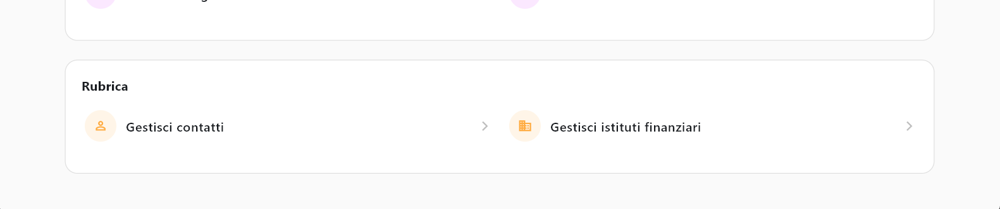
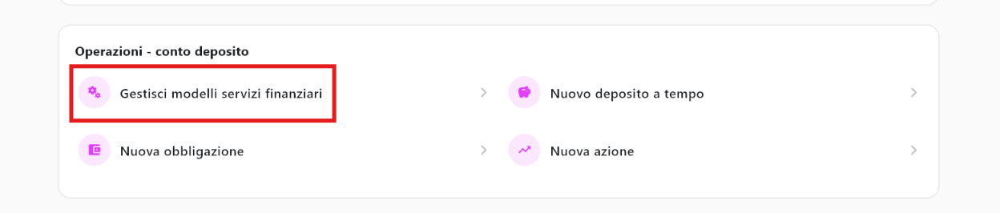
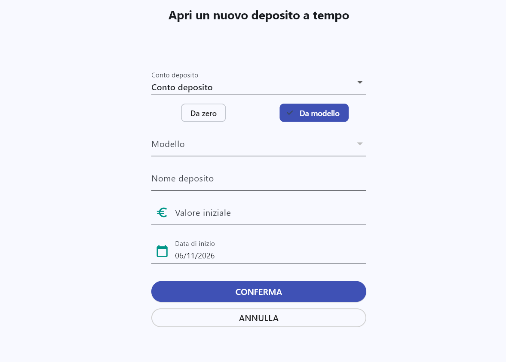
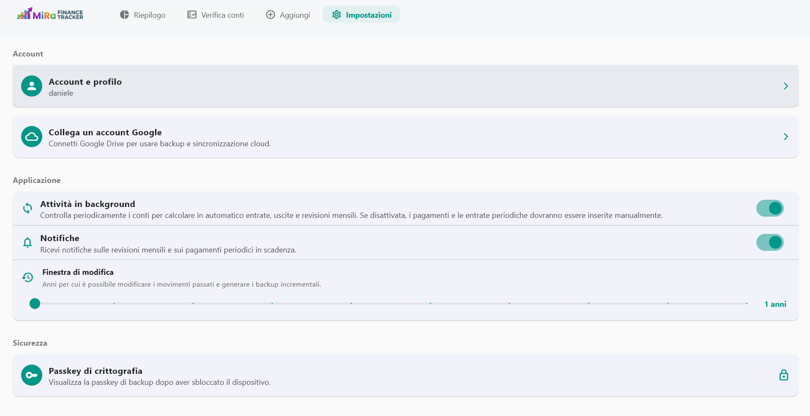
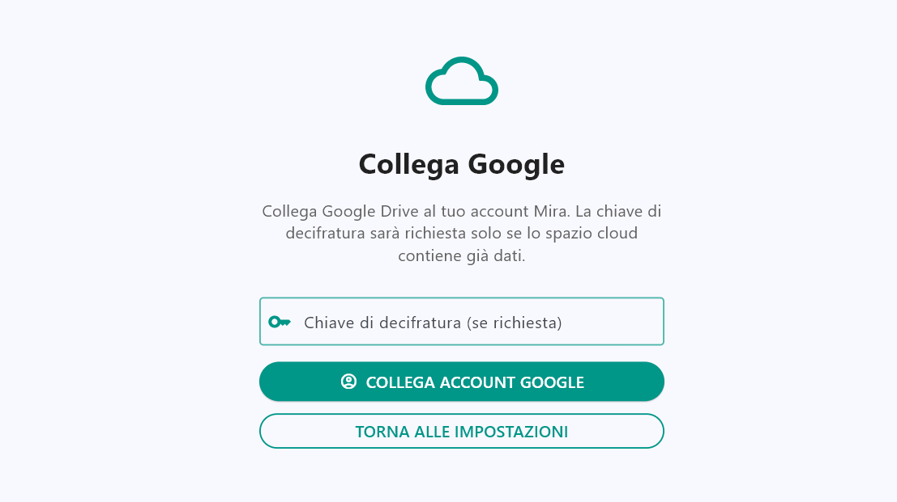

# User guide
This document is meant to let the end user know which settings are available inside the application, how to restart the application after some errors, and how to use the available resources in the best possible way. 

This document is divided into sections according to the aspect of the application covered. 
**It won't display all the functionalities available in the application, only those that are likely to be misunderstood or to generate errors.**

## Account management
When first entering the application, the access page will be displayed, giving the possibility to log in, sign up or manage accounts. 

If you want to log in, just enter the credentials and access. 
Otherwise, you may find it useful to go to these pages:

### Sign-up page

This page allows the user to create a new account inside the application. 
The software supports the use of multiple accounts on every platform. 
**Required fields are followed by the * symbol**.
Among the fields there is a particular one to take into account, which is the ***user passkey*** you can see at the end of the image. It has to be at least **10 characters long** and can be either chosen by the user or randomly generated by the application.
***Remember that the passkey is mainly used to connect to the cloud from another application instance using the same account as yours. This password will also be displayed inside the user settings after local authentication***.

### Account management page

When you're locked out of the account and you don't know how to recover it, the account management page can be helpful. 
In this section, after entering local authentication (device PIN, fingerprint, face ID), it is possible to control the basic settings for every account registered on the device. 
In particular, it is possible for each user to:
- **Change password** if you don't remember it
- **Delete the account** if you don't want to access this account anymore. This is the only point inside the application where it is possible to do this action.
***All the operations are completed only after a second local authentication.***

## Account resources
This section will cover all the useful tips to use the main resources designed inside the application. In particular, it is possible to create bank accounts, manage transactions and view a review of the enabled financial instruments.
To move from one place to another, it is possible to use the top navbar or the side "hamburger" button.

### Home page
The home page is the landing page of the application after the login. On the home page it is possible to view:
- **MONTHLY STATUS** with total incomes and outcomes of the month
- **PATRIMONY DISTRIBUTION** showing, with a pie chart, the distribution of the user's money among the registered bank accounts.
- **RECENT TREND** showing a bar graph of total incomes and outcomes of the last six months.
- **RECENT TRANSACTIONS** a list of the last 10/15 transactions across all the bank accounts. These transactions are not editable; they can be edited on the single bank account page.

***The home page has a section to access the single bank accounts. It displays the available balance of the bank accounts, divided by type: current accounts, savings accounts and cards. Click on one of these pages to look for the single bank account of the required type.***

### Bank Account Page
By clicking on one of the pages mentioned above, it is possible to show the list of current accounts, savings accounts or cards. It is possible to have more than one bank account for each type. To change the bank account, use the top section. 
Each bank account has a summary card to explain its status:

On this page it is possible to use three GUI commands to change the status of the bank account:
- **DISABLE BANK ACCOUNT** represented by a switch. Disabling a bank account means that it is not possible to register new services or actively interact with the services registered inside it.
- **EDIT BANK ACCOUNT** editing the bank account allows the user to change the available balance (and the ledger balance in the case of a savings account), the IBAN and the interest rate.
- **DELETE BANK ACCOUNT** erasing it also permanently deletes the services connected to it.

After the status card it is possible to see a new section with the services you can configure, which depend on the type of bank account you're interacting with. For each service it is possible to search, add, update and delete it, fully implementing the CRUD paradigm. 

***Another section to consider while using a bank account is the transaction section, which potentially displays all the registered transactions connected to the bank account.***

***Each transaction (even those generated by the background task) can be edited or deleted. In particular, the name or the amount of a transaction can be changed. When using these commands, the result automatically affects the available balance, which will increase or decrease depending on the type of transaction.***

### Subjects section
Inside the Action Page named "Aggiungi" it is possible to add new entities related to the user and fully manage the financial subjects. 

At the bottom of the page there is a section called "Rubrica", where it is possible to manage financial institutes and counterparties of your transactions. 

Each of them has an interface similar to the one representing the services inside a bank account. So, it is possible to create, change and delete the subjects you want.
***Pay attention: you cannot delete subjects connected to existing financial objects saved inside the application. First delete the related entities to be able to erase the financial subjects as well***.

### Financial instrument models
Before the subject section you can find another link dedicated to the management of financial instrument models. This page allows the user to handle time deposit and bond models using an interface similar to the one described in the subject section. 

Once the procedure is completed, it is possible, when creating a financial instrument, to use a model and complete the remaining data, with less possibility of making mistakes.

## Settings configuration
This is how the settings page is displayed to the end user:

The page is divided into three different sections:

### User profile
Inside the user profile it is possible to:
- **MANAGE ACCOUNT** by changing the password, personal data or logging out
- **GOOGLE AUTHENTICATION** with the possibility to authenticate or log out when the user has already logged in to the Google account. When it is time to access, the following page will be displayed:

### User preferences
For each application it is possible to handle some of the user preferences, such as:
- **Enable notifications**
- **Enable background** task execution, daily
- **Saving time window** the time window the backup has to consider when synchronizing files. It is expressed in years
Some of these preferences are unique to every device the application is installed on, while others (like the time window) are shared among the application instances connected to the same user.

### User passkey
It is the passkey created by the user during the signup procedure and can be seen by the user after entering local authentication credentials. 
This has to be used when accessing one of the [user profile settings](#user-profile) described above.