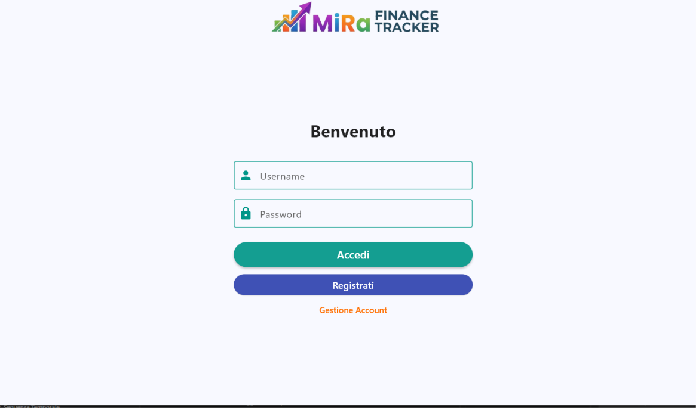
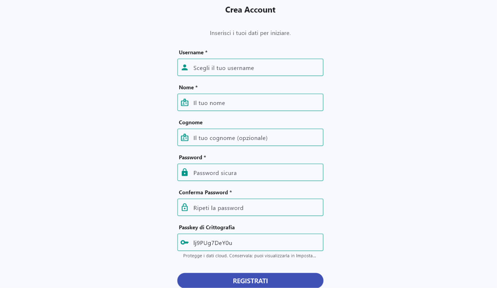
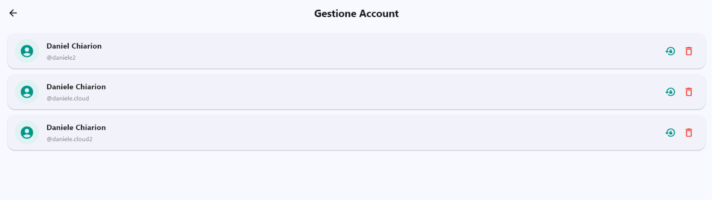
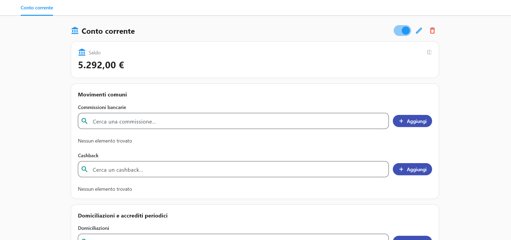
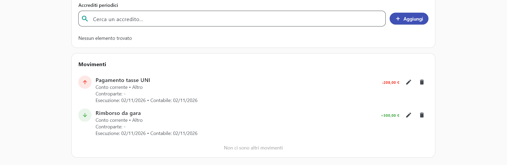

# User guide
This document is realized in order to let the end user know which settings are available inside the application to restart the application after some errors and use the resources available in the best possible way. 

This document will be divided in sections considering the aspect of the application is covered.

## Account management
When entering first the application, it will be displayed the access page, giving the possibility to login, sign up or manage accounts. 
. 

If you want to login, just write the credentials and access. 
Otherwise, you could find useful going into these pages:

### Sign-up page

This page allows the user to create a new account inside the application. 
The software supports the use of multiple accounts for every platform. 
**Required fields are followed by the * simbol**.
Among the fields there is a particular field to take into account, which is the ***user passkey*** you can see at the end of the image. It has to be at least **10 characters long at least** and can be both decided by the user or let the random string generated by the application.
***Remember that the passkey is mainly use to connect to the cloud another application using the same account as yours. This password will be also displayed inside the user settings after local authentication***.

### Account management page

When you're locked out the of the account and you don't know how to recover the account, the account management page could be helpful. 
In this section, after entering local authentication (device pin, fingerprint, face ID), it is possible to control the basic settings for every account registered inside the device. 
In particular, it is possible for each user to:
- **Change password** if you don't remember it
- **Delete the account** if you don't want to access to this account anymore. This is the only point inside the application where it is possible to do this action.
***All the operations are completed only after a second local authentication.***

## Account resources
This section will cover all the useful tips to use the main resources designed inside the application. In particular, it possible to create bank accounts, managing transactions and show a review of the financial instruments enabled.
To move from a place to another it is possible to user the navbar or top or visible tapping a side "hamburger" button. 

### Home page
The home page is the landing page of the application after the login. It is possible to view inside the home page:
- **MONTHLY STATUS** with total incomes and outcomes of the month
- **PATRIMONY DISTRIBUTION** showing with a pie chart of the distribution of the user's money among the bank accounts registered.
- **RECENT TREND** showing a bar graph of total incomes and outcomes of the last six months.
- **RECENT TRANSACTIONS** a list of the last 10/15 transactions throughout all the bank accounts. This transactions are not editable, which can be done inside the single bank account page.

***Inside the home page there is a section to access to the single bank accounts. It displays the available balance of the bank accounts divide by their types: current accounts, saving accounts and cards. Click on one of these pages to look for the single bank account of the type required.***

### Bank Account Page
Clicking on one of the pages given before it is possible to show the list of current accounts or savings accounts or cards. It is possible to have more than one bank account for each type. To change bank account use the the top section to change bank account. 
Each bank account has a summary card to explain his status:

In this page is possible to use two gui commands to change the status of the bank account:
- **DISABLE BANK ACCOUNT** represented by a switch. Disabling bank account means that in the bank account is not possible to register new services or actively interact with the services registered inside.
- **EDIT BANK ACCOUNT** editing the bank account allows the user to change the available balance (even ledger balance when there is a saving account), the IBAN and the interest rate.
- **DELETE BANK ACCOUNT** erasing also the services connected to it permanently. 

After the status card it is possible to see a new section with the services you can configure, which depends on the type of bank account you're interacting with. For each service it is possible to search it, add it, update it, delete it, fully implementing the CRUD paradigm. 

***Another section to consider while using a bank account is the transaction section, which displayed potentially all the transactions registered connected to the bank account.***

***Each transaction (even the one generated inside the background task) can be edited or deleted. In particular, a transaction could change its name or its amount. When using this commands, the result affects automatically the available balance, which will increase or decrease depending on the type of transaction.***